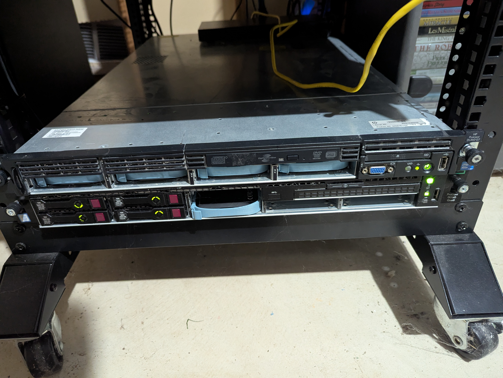
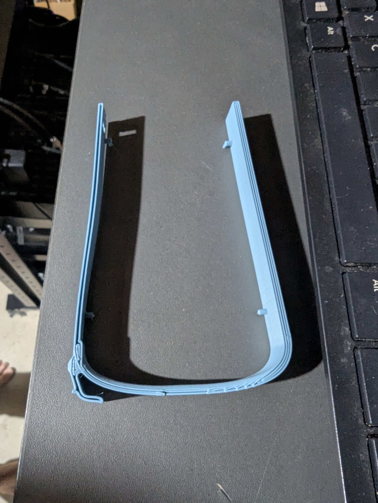

[In a previous post](https://sodakhacker.space/projects/proxmox/) I discussed the installation of our main proxmox node, blackelk. The original hackerspace server was a beefy laptop I had lying around. I managed to get a new proper rackmount server a few months back, an HP Proliant DL360 G7. This server offers a significant boost in resources to the hackerspace and as such resulted in the decommission of the old laptop server and a fresh install of Proxmox for the hackerspace. 

The principles are mostly the same from the initial install. There were a number of minor hiccups (bad power supply needed replacing, different storage setup because of additional disks, etc) but the install was your typical Proxmox install. One of the main benefits of this Proxmox installation was the storage capability increase. Obviously having 8 drive bays greatly expanded the capacity for VM storage, backups, isos, etc. I still chose BTRFS as the main filesystem for the VM storage due to the snapshotting ability. Currently there's a single 1TB 2.5in SSD installed that stores the VM and container disks, as well as templates and a second BTRFS disk that stores ISOs, backups, and container images. I would like to eventually get a ZFS pool setup once I get at least two disks to set them up in a RAID configuration. 

**Note the hackerspace server is the one on top. I know it's not best practice to stack servers like this but I don't have rails to properly mount.**

One neat trick that I picked up was 3D printing some hard drive caddies for the server. Official hard drive caddies are expensive, even on eBay. Printing them saved money and added some ... character to the server. Obviously we miss out on the clean look but hey, this is a community project. You can find the link to the caddy I printed [here](https://www.printables.com/model/1005854-hpe-server-25-caddy-651687-gen8-gen9-gen10-prolian) 

